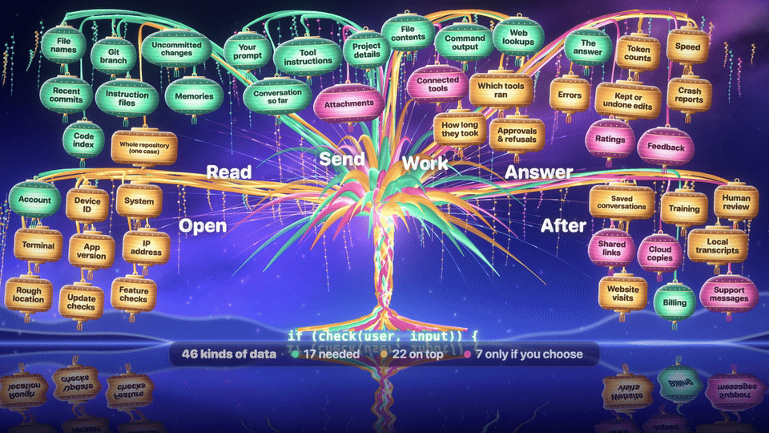

# One Prompt

A developer asks a coding agent to fix one bug. The film follows everything a coding agent, open or closed source, can send
along the way: before the prompt, with it, during the work, with the answer, and afterward.

## Model

- **Model:** Claude Opus 5.5 (`claude-opus-5-5`) in Claude Code. Narration script drafted by Gemini 4 Neon (Extra High) in
  Antigravity, then fact-checked; voice by ElevenLabs (`eleven_v4`, voice "Jennica").

## Generate the video

Prerequisites: Node ≥ 22, `ffmpeg`, Playwright's `chrome-headless-shell` (or Google Chrome), Python 3 with `numpy` and
`scipy`. Text uses SF Pro Rounded and SF Mono.

1. Narration: generate each line of `audio/voice.json` with ElevenLabs (that voice and model) and save it as
   `out/vo/<line id>.mp3`. Then measure the lines and paste the printed `VO` map into `src/timeline.js`:

```bash
cd projects/one-prompt
python3 audio/score.py measure out/vo
```

2. Word timings for the subtitles: transcribe each line with ElevenLabs Scribe (`eleven_scribe_v1`) and save its
   word list as `out/scribe/<line id>.json`. Then the timings, the score (composed in code to the cue sheet) and the mix
   (narration, effects, ducked music):

```bash
node audio/say.mjs > out/say.json
python3 audio/scribe_words.py out/scribe out/vo out/say.json > out/vo_words.js && mv out/vo_words.js src/vo_words.js
node audio/cues.mjs > out/cues-audio.json
python3 audio/compose.py out/cues-audio.json out/music.wav
python3 audio/score.py mix out/cues-audio.json out/vo out/one-prompt.wav --music out/music.wav
ffmpeg -i out/one-prompt.wav -af loudnorm=I=-16:TP=-1.5:LRA=11 -ar 48000 out/one-prompt-norm.wav
```

3. Picture, then both together:

```bash
node render/render.mjs --samples 6 --name one-prompt
ffmpeg -i out/one-prompt.mp4 -i out/one-prompt-norm.wav -map 0:v -map 1:a -c:v copy -c:a aac -b:a 256k -shortest out/one-prompt-final.mp4
```

Other commands: `node render/render.mjs --act vault --from 70 --to 76` renders part of one act to `out/preview.mp4`;
`node render/render.mjs --stills 12,40,90 --sheet check` makes a contact sheet. Preview with a player:
`npx serve -l 4110 .` and open http://localhost:4110.
